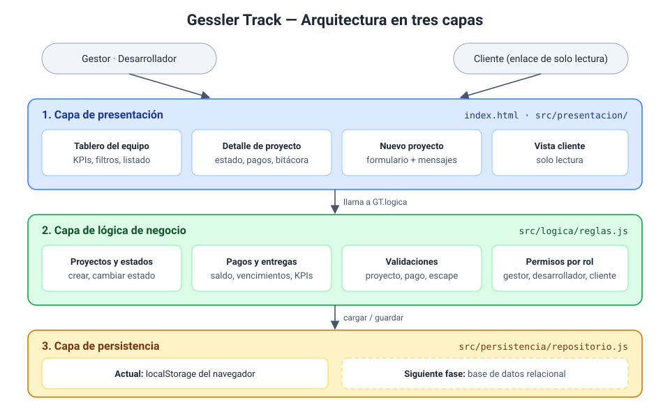

# GesslerTrack
GesslerTrack es una herramienta de gestion para la empresa Gessler, unicamente trabajando Nestor Benitez con Claude.

Sistema web para el seguimiento de proyectos, pagos y entregas de Gessler.

- **Repositorio:** https://github.com/NestorBenitez0297/GesslerTrack
- **Avance por funcionalidad:** [pull requests](https://github.com/NestorBenitez0297/GesslerTrack/pulls?q=is%3Apr) · [ramas](https://github.com/NestorBenitez0297/GesslerTrack/branches) · [historial de `develop`](https://github.com/NestorBenitez0297/GesslerTrack/commits/develop)

## Uso
- **Aplicación:** abrir `index.html` en el navegador. El selector **Rol** cambia entre Gestor, Desarrollador y Cliente (también `index.html?rol=cliente`).
- **Pruebas:** abrir `tests/index.html` en el navegador; muestra los 22 casos y su resultado.
- **Datos:** se guardan en el navegador (localStorage). El botón *Restablecer demo* vuelve a los datos de demostración.

## Estructura del proyecto

```
GesslerTrack/
├── index.html                       # Punto de entrada de la aplicación
├── src/
│   ├── presentacion/                # Capa de presentación (interfaz web)
│   │   ├── css/styles.css
│   │   └── js/app.js
│   ├── logica/reglas.js             # Capa de lógica: proyectos, pagos, entregas, validaciones, roles
│   └── persistencia/repositorio.js  # Capa de persistencia: cargar / guardar / reiniciar
├── tests/                           # Casos de prueba por historia de usuario (CP-01 a CP-22)
├── assets/img/                      # Imágenes y recursos estáticos
├── docs/
│   ├── Informe-tecnico-Proyecto-Gessler.md / .docx; «Informe técnico - Proyecto Gessler.pdf»
│   ├── backlog.md                   # Backlog priorizado y trazabilidad HU → código → prueba
│   └── img/                         # arquitectura.svg y figuras del informe (img/informe/)
└── .githooks/commit-msg             # Validación de nomenclatura de commits
```



## Documentación
- [Informe técnico - Proyecto Gessler](docs/Informe-tecnico-Proyecto-Gessler.md) ([PDF](docs/Informe%20t%C3%A9cnico%20-%20Proyecto%20Gessler.pdf) · [DOCX](docs/Informe-tecnico-Proyecto-Gessler.docx))
- [Backlog y trazabilidad](docs/backlog.md)
- [Guía de contribución: ramas y commits](CONTRIBUTING.md)
